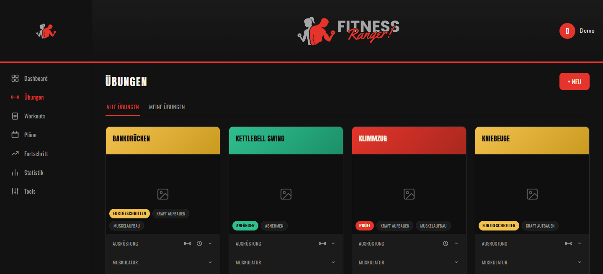
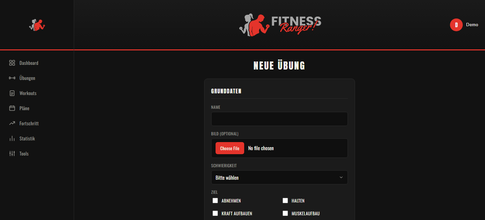
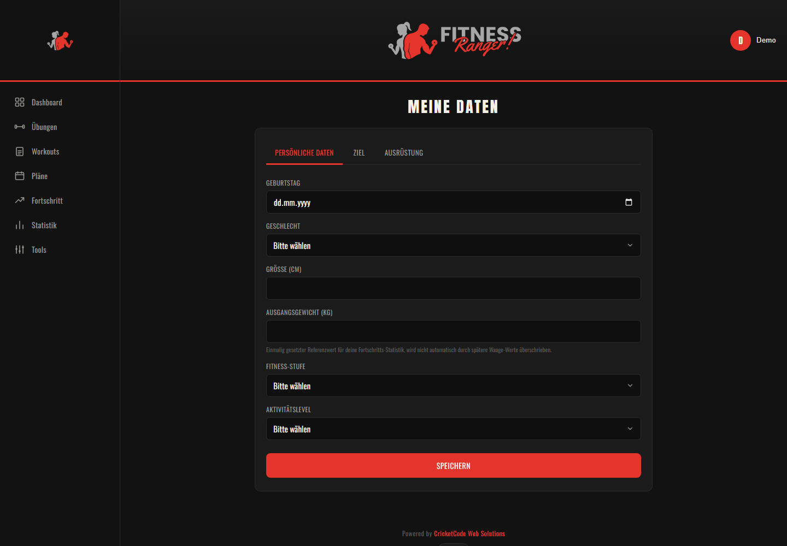
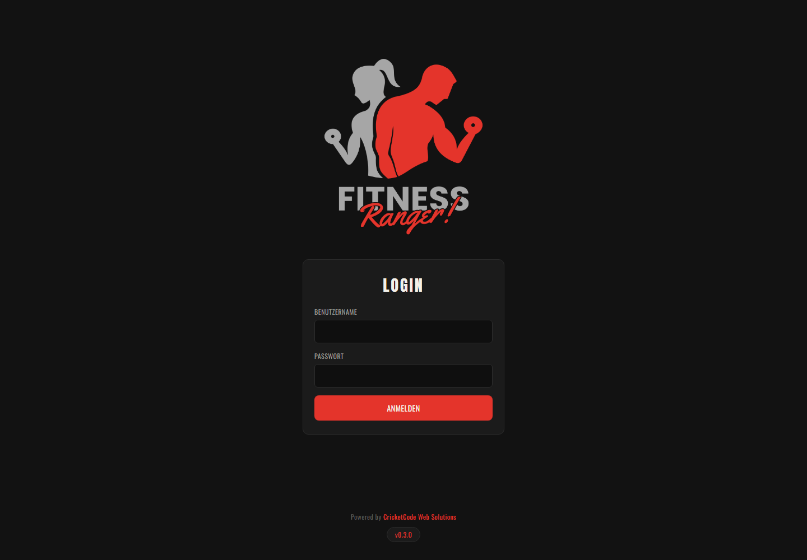

<div align="center">


<br/><br/>

# FitnessRanger!

### A self-hosted fitness app for exercises, workouts and training plans

Build a shared exercise library and keep your personal training data separate from
everyone else's. Your data stays on your own server.

<p>
  
  
</p>

**[Overview](#-overview)** ·
**[Features](#-features)** ·
**[Screenshots](#-screenshots)** ·
**[Getting Started](#-getting-started)** ·
**[Configuration](#-configuration)** ·
**[Roadmap](#-roadmap)**

</div>

<br/><br/>

##  Overview

**FitnessRanger!** is a multi-user fitness app for your home server. Exercises and workouts form
a library that all users share and can extend. Plans, tracking and progress belong to each user.

The exercise library, personal data and accounts already work. Workouts and training plans can
only be listed so far, and creating them still happens in the Django admin. Tracking, statistics
and the calculators don't exist yet. The interface is in German.

<br/>

> [!WARNING]
> FitnessRanger is at an early stage and has no release yet. There is no production image, it
> only runs on Django's development server, and it has hardly any automated tests. Please use it for
> trying things out and don't expose it to the internet.

<br/><br/>

##  Features

- **Exercise library** – Exercise cards with difficulty, training goals, equipment and a short description, filterable by all exercises or your own.
- **Adding exercises** – A form for image, difficulty, goals, force, mechanic, grip, video link, instructions and equipment, with primary and secondary muscles chosen separately.
- **Personal data** – Body data, fitness level, activity level, your goal and your equipment. You can add missing equipment right there.
- **Calculators** – BMI, calories (Mifflin-St Jeor), macronutrients, 1RM with a percentage table, heart rate zones and body fat (Navy method). They can use your saved data and units, and they don't store anything.
- **Settings** – Language and units per user. Only German is available so far, and the units don't affect any values yet.
- **Personal backup** – Every user can download their own data as a ZIP file. It can't be restored in the app yet.
- **System backups** – Admins get automatic backups with an adjustable interval and retention, manual backups, download and restore. A restore checks the file first, saves the current state and rolls back if it fails.
- **User management** – Admins can create, edit, lock and delete accounts in the app.
- **Danger Zone** – Admins can delete all training data or reset the installation. Both need a typed confirmation and the admin password, and they save a safety copy first.
- **Profile** – Upload an avatar and change your username, display name, email address or password.
- **Accounts** – Log in with your username or email address, with data separated per user. There is no sign-up page, admins create new users.
- **Reference data** – 50 muscle regions, 21 pieces of equipment and 4 training goals are included. Exercises are not, so the library starts empty.
- **REST API** – Endpoints for exercises, workouts, equipment and muscle groups, available after logging in.
- **Changelog** – The version number in the footer opens the release notes.

<br/><br/>

##  Screenshots

<div align="center">

| Exercise library | New exercise |
| :---: | :---: |
|  |  |

| Personal data | Login |
| :---: | :---: |
|  |  |

</div>

<br/><br/>

##  Tech Stack

| **Area** | **Technology** | **Purpose** |
| :--- | :--- | :--- |
| **Backend** |  | Django 6.1 with session login, Pillow for image uploads |
| **API** | Django REST Framework | JSON endpoints for the shared library |
| **Frontend** |  | Django templates, plain CSS and JavaScript without a build step |
| **Database** |  | One SQLite file |

<br/><br/>

##  Getting Started

### Prerequisites

- Python 3.12 or newer

### Installation

```bash
git clone https://github.com/xXJimnyCricketXx/FitnessRanger.git
cd FitnessRanger
python -m venv .venv
.venv/Scripts/activate    # Linux/macOS: source .venv/bin/activate
pip install -r requirements.txt
cp .env.example .env      # set your own DJANGO_SECRET_KEY
python manage.py migrate
python manage.py loaddata seed_catalog
python manage.py createsuperuser
python manage.py runserver 8100
```

The app is now available at:

```text
http://localhost:8100
```

Sign in with the account you just created. More users can be added under *Einstellungen → System*.

Automatic backups need a second process next to the server: `python manage.py backup_scheduler`. The Docker container starts it on its own.

<br/><br/>

##  Configuration

All settings are environment variables in `.env`.

| Variable | Required | Default | Description |
| --- | :---: | --- | --- |
| `DJANGO_SECRET_KEY` | ❌ | insecure development key | Signs sessions. Set your own long random value |
| `DJANGO_DEBUG` | ❌ | `True` | Debug mode. CSS, images and uploads are currently only served while this is `True` |
| `DJANGO_ALLOWED_HOSTS` | ❌ | empty | Comma-separated host names the app answers to, e.g. `localhost,127.0.0.1` |
| `DJANGO_DB_PATH` | ❌ | `db.sqlite3` in the project folder | Path to the SQLite database |
| `DJANGO_MEDIA_ROOT` | ❌ | `media/` in the project folder | Folder for uploaded images |
| `DJANGO_BACKUP_DIR` | ❌ | `backups/` in the project folder | Folder for system backups |

> [!IMPORTANT]
> The database and the uploaded images hold all your data and are not part of the repository.
> System backups stay on the same disk and contain the data and password hashes of all users.
> Download important backups and keep them somewhere safe.

<br/><br/>

##  Project Structure

```text
FitnessRanger/
├── accounts/            # login, profile, personal data, changelog.json
├── catalog/             # muscle groups, equipment, exercises, workouts, REST API, body map
│   └── fixtures/        # reference data for the first start
├── plans/               # training plans and a user's equipment
├── tools/               # calculators
├── tracking/            # data model for logged training sessions, no pages yet
├── progress/            # data model for body metrics and goals, no pages yet
├── config/              # Django settings and URLs
├── templates/           # HTML templates
├── static/              # stylesheet, scripts, logos, muscle illustrations
├── docs/screenshots/
├── docker-compose.test.yml  # fixed test container
├── docker-entrypoint.sh     # migrations and first-start setup
├── Dockerfile
├── manage.py
├── requirements.txt
└── .env.example
```

<br/><br/>

##  Roadmap

There are no releases yet. The first runnable version will be published as tagged release **1.0.0**, and every version after that gets its own tag.

| **Stage** | **Features** | **Status** |
| :---: | :--- | :---: |
| **Later** | <ul><li>Production Docker image and Unraid template</li><li>Training plan editor and plan wizard with automatic plan suggestions</li><li>Dashboard with today's training and daily tracking</li><li>Progress diary with RENPHO CSV import, statistics and goal forecast</li><li>Connections to wearables and scales</li><li>Password reset</li><li>Restoring personal backups</li><li>More languages, and units applied across the app</li></ul> |  |
| **Next** | <ul><li>Body map that shows the trained muscles correctly on the purchased illustrations</li><li>Detail pages for exercises, workouts and plans</li><li>Form for building workouts</li><li>Editing and deleting</li></ul> |  |
| **So far** | <ul><li>Data model and REST API</li><li>Login, sidebar navigation and user menu</li><li>Personal data: body data, goal and equipment</li><li>Profile: avatar, username, display name, email address and password</li><li>Calculators</li><li>Settings page with language and units</li><li>Personal backup download</li><li>System backups with schedule, retention and restore</li><li>User management and Danger Zone</li><li>Card overviews for exercises, workouts and plans</li><li>Form for adding exercises</li></ul> |  |

See the [open issues](../../issues) for planned features and known problems.

<br/><br/>

##  Development

Set up the project as described under [Getting Started](#-getting-started), then start the development server:

```bash
python manage.py runserver 8100
```

The app uses port `8100` because other local projects may already be using Django's default port.

Automated tests only cover accounts, settings, backups, user management, the Danger Zone and the calculators so far. In the test container, run them with `docker exec fitnessranger_test python manage.py test`.

The calculator formulas have their own JavaScript tests. They need Node.js 18 or newer and run outside the container with `node --test "tests/js/*.test.js"`.

After changing a model, create and apply its migration:

```bash
python manage.py makemigrations
python manage.py migrate
```

### Test container

A fixed container for checking changes before publishing. It builds from your working copy, so uncommitted changes are included, and it keeps its own database and uploads in a named volume, separate from your local data.

```bash
docker compose -f docker-compose.test.yml up -d --build   # build and start, also after every change
docker compose -f docker-compose.test.yml down            # stop, data stays
docker compose -f docker-compose.test.yml down -v         # stop and delete the test data
```

The app is then available at `http://localhost:18107`, with the login `admin` / `admin`. The port is only reachable from your own computer.

<br/><br/>

##  Contributing

Issues and pull requests are welcome. Please open an issue first for larger changes.

<br/><br/>

##  License

All rights reserved. The source code is public for viewing only. It may not be used, copied, modified or distributed without written permission.

<br/><br/>

---

<br>

<div align="center">

<a href="https://github.com/xXJimnyCricketXx">
  
</a>
<a href="https://cricketcode.de">
  
</a>

</div>
